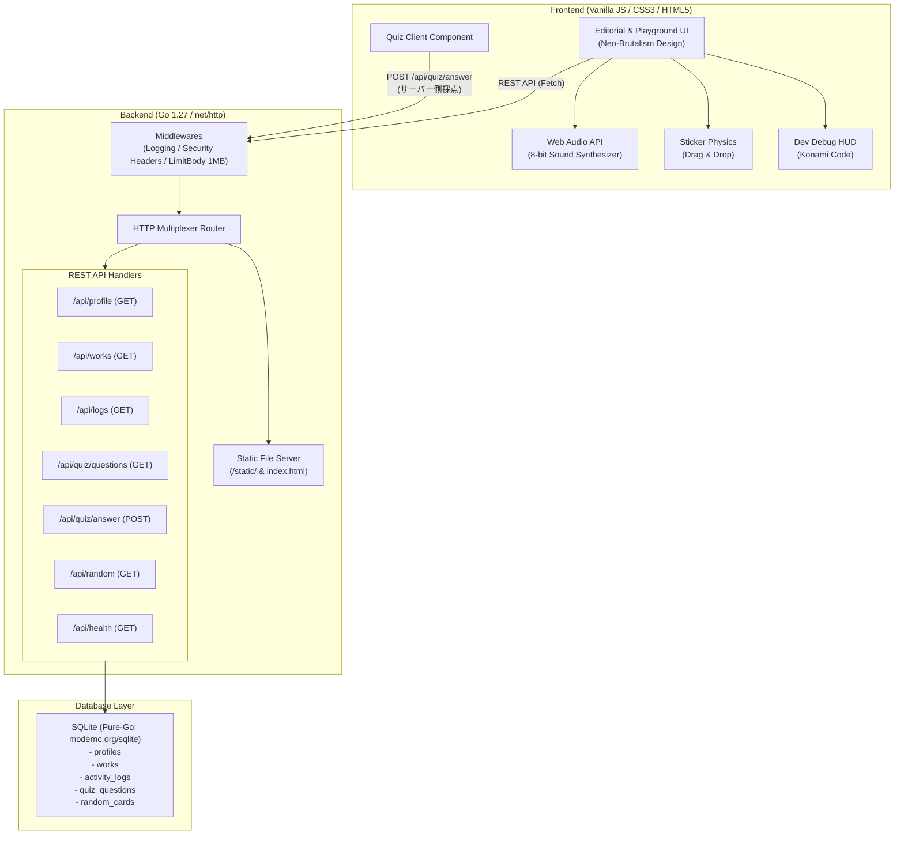

# FUWAFUWA PORTFOLIO
### Digital Playground × Editorial / Magazine // Interactive Profile Application

雑誌の特集記事をめくるような知的好奇心と、ゲーム空間を探索・操作して遊べる仕掛けを融合させ、Go言語による堅牢なバックエンドとPure-Go SQLite、そしてVanilla JavaScriptによって構築されています。

---

## 1. システム構成図 (System Architecture)

---

## 2. コンセプト & デザイン思想

### 雑誌エディトリアル (Editorial / Magazine)
- **大胆なタイポグラフィと見出し**: 巨大なフォントサイズ、斜めリボン、バーコード、発行番号（ISSUE 2026.11 VOL.01）。
- **非対称グリッド & 密集レイアウト**: セクションごとに異なるカードと多重情報構造。
- **特集コラム**: 02/INTERESTSではゲーム、音楽、数学、プログラミングなどを雑誌のインタビュー・特集記事として整理。

### 遊び場 (Digital Playground)
- **ドラッグ可能なステッカー**: 画面上のステッカーをマウスやタッチで自由に動かせる物理インタラクション。
- **8-bitレトロ効果音エンジン**: 外部の音声ファイルを用いず、ブラウザの `Web Audio API`（矩形波・三角波の波形合成）でリアルタイム生成。
- **サーバー採点式ミニクイズ**: クライアント側に正解を持たせず、Goサーバーサイドで厳格に採点。
- **隠し要素 (Easter Eggs)**:
  - ロゴのタップやステッカー操作で実績解除トースト通知。
  - サイト探索スタンプカウンター。
 
 ---
