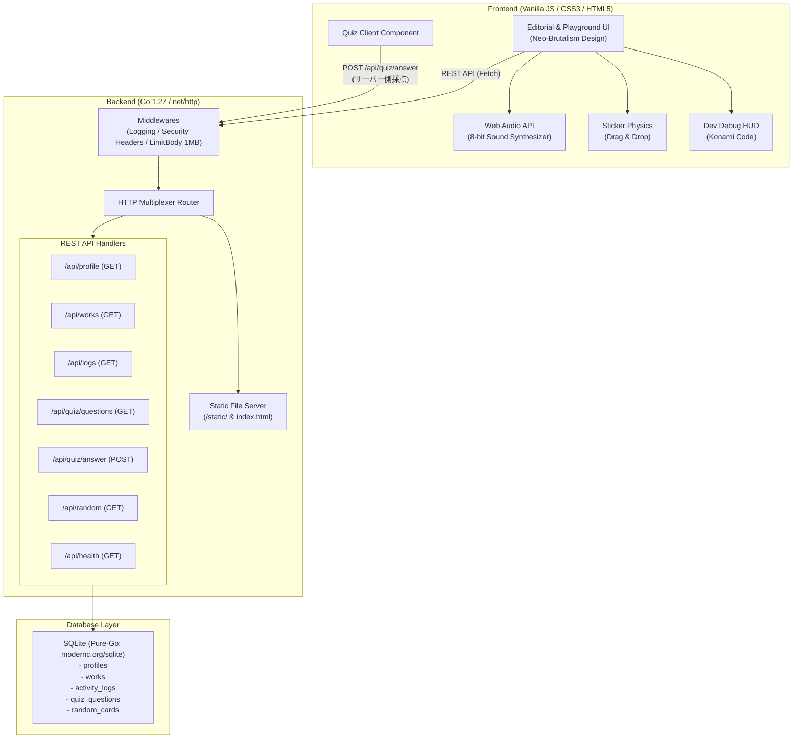

# FUWAFUWA PORTFOLIO ⚡
### Digital Playground × Editorial / Magazine // Interactive Profile Application

ゲーム開発会社の**サーバーサイドエンジニア向けインターンシップ応募作品**として制作した、完成度の高いフルスタックWebアプリケーションです。  
雑誌の特集記事をめくるような知的好奇心と、ゲーム空間を探索・操作して遊べる仕掛けを融合させ、Go言語による堅牢なバックエンドとPure-Go SQLite、そしてVanilla JavaScriptによって構築されています。

---

## 1. システム構成図 (System Architecture)



---

## 2. コンセプト & デザイン思想

### 雑誌エディトリアル (Editorial / Magazine)
- **大胆なタイポグラフィと見出し**: 巨大なフォントサイズ、斜めリボン、バーコード、発行番号（ISSUE 2026.11 VOL.01）。
- **非対称グリッド & 密集レイアウト**: セクションごとに異なるカードと多重情報構造。
- **特集コラム**: 02/INTERESTSではゲーム、音楽、数学、プログラミングなどを雑誌のインタビュー・特集記事として整理。

### 遊び場 (Digital Playground)
- **ドラッグ可能なステッカー**: 画面上のステッカーをマウスやタッチで自由に動かせる物理インタラクション。
- **8-bitレトロ効果音エンジン**: 外部の音声ファイルを用いず、ブラウザの `Web Audio API`（矩形波・三角波の波形合成）でリアルタイム生成。
- **サーバー採点式ミニクイズ**: クライアント側に正解を持たせず、Goサーバーサイドで厳格に採点。
- **隠し要素 (Easter Eggs)**:
  - コナミコマンド（`↑ ↑ ↓ ↓ ← → ← → B A`）でサーバーメトリクスHUDが起動。
  - ロゴのタップやステッカー操作で実績解除トースト通知。
  - サイト探索スタンプカウンター。

---

## 3. カラーパレット (Neo-Brutalism)

| 色名 | カラーコード | 用途 |
|---|---|---|
| **ビビッドピンク** | `#FF007B` | アクセント、重要バッジ、ハイライト |
| **シアン** | `#20CBE5` | テクノロジー、サーバー、データカード |
| **イエロー** | `#FFE14A` | 警告、ステッカー、レトロタグ、スコア |
| **ブラック** | `#171717` | 極太ボーダー (3〜4px)、オフセットシャドウ、ヘッダー |
| **ホワイト** | `#FFFFFF` | カード背景、ハイコントラストテキスト |

---

## 4. サイト構成 (5つのセクション)

- **`00 / INDEX`**:
  - 特大タイトル「FUWAFUWA PORTFOLIO」と浮遊ロゴ
  - 自己紹介の簡単な概要（エディターズノート）
  - 各セクションへのナビゲーションチケット
  - 隠し要素の示唆とマーキーストリップ
- **`01 / ABOUT`**:
  - クリエイターインタビュー＆価値観
  - ゲームステータス画面風パラメータ（Go、並行処理、DB、ネットワーク等）
  - 技術キーワードバッジ
- **`02 / INTERESTS`**:
  - 特集記事 #01〜#06（音楽・ゲーム・アニメーション・数学・並行プログラミング・ハードウェア）
- **`03 / ARCHIVE`**:
  - 制作物（自作Web、Discord Bot、WebSocketサーバー、ログ解析ツール）
  - カテゴリー別フィルター（ALL, WEB, BOT, TOOL, LAB）＆リアルタイムインクリメンタル検索
  - 試行錯誤や課題解決を読める詳細モーダル
  - 日々の活動・ベンチマークログ
- **`04 / PLAY`**:
  - **Random Generator**: ガチャ風アイデア＆トリビアディスペンサー
  - **Mini Quiz**: Goサーバー採点式のゲームサーバー技術力判定クイズ（正誤判定、解説、ランク認定）

---

## 5. 技術スタック

### フロントエンド
- **HTML5 / CSS3 / JavaScript (Vanilla JS)**:
  - React等の重厚フレームワークに依存せず、ブラウザ標準APIを最大限に活用。
  - レスポンシブ対応（スマホ・PC両対応）。
  - ネオブルータリズムのオフセットシャドウとマイクロインタラクション。
  - Web Audio APIによるシンセサイズド音響エンジン。

### バックエンド
- **言語**: Go 1.27
- **HTTP**: `net/http`（Go標準ライブラリ）
- **データベース**: SQLite (`modernc.org/sqlite` によるPure-Go実装。WindowsやLinuxでCコンパイラ(gcc)不要、単一バイナリでポータブル動作)
- **JSON**: `encoding/json`

---

## 6. REST API 仕様

| メソッド | エンドポイント | 説明 | パラメータ |
|---|---|---|---|
| `GET` | `/api/health` | サーバー健全性、稼働時間、goroutine数 | なし |
| `GET` | `/api/profile` | プロフィール、ビジョン、キーワード、ステータス | なし |
| `GET` | `/api/works` | 制作物一覧取得 | `category` (任意), `q` (検索語) |
| `GET` | `/api/logs` | 活動・学習記録取得 | `limit` (デフォルト: 10) |
| `GET` | `/api/quiz/questions` | クイズ問題取得 (※正解は除外) | なし |
| `POST` | `/api/quiz/answer` | クイズの回答採点 | Body: `{"question_id":"q-01", "selected_index":0}` |
| `GET` | `/api/random` | ランダム豆知識・スニペット取得 | なし |

### クイズ採点 API (POST /api/quiz/answer) 例
```bash
curl -X POST http://localhost:8080/api/quiz/answer \
  -H "Content-Type: application/json" \
  -d '{"question_id": "q-01", "selected_index": 0}'
```
レスポンス:
```json
{
  "is_correct": true,
  "explanation": "OSスレッドのスタックサイズが通常1MB〜2MBであるのに対し、goroutineの初期スタックはわずか約2KB〜4KBで...",
  "points": 10
}
```

---

## 7. セキュリティ & 品質への配慮

1. **SQLインジェクション対策**:
   - すべてのSQLクエリでプレースホルダー（`?`）を徹底使用。
2. **リクエストサイズ制限**:
   - `http.MaxBytesReader` をミドルウェアに組み込み、1MBを超える不正リクエストを遮断。
3. **セキュリティヘッダー**:
   - `X-Content-Type-Options: nosniff`
   - `X-Frame-Options: DENY`
   - `X-XSS-Protection: 1; mode=block`
   - `Referrer-Policy: strict-origin-when-cross-origin`
4. **データの整合性 & トランザクション**:
   - シードデータや重要処理に `tx.Begin()` と `tx.Commit()` / `tx.Rollback()` を適用。
5. **テストコードの完備**:
   - `go test -v ./...` によりAPIハンドラー、クイズ正解秘匿性、採点ロジック、バリデーションエラーを網羅的に自動テスト（すべてパス済み）。

---

## 8. 起動手順

### 前提条件
- Go 1.22以上（動作確認: Go 1.27.4）

### サーバー起動
```powershell
# ルートディレクトリで実行
go run ./cmd/server
```
または、ビルド済みバイナリを実行:
```powershell
.\server.exe -port 8080
```

起動後、ブラウザで以下のURLを開いてください：
👉 **http://localhost:8080**

### 単体テストの実行
```powershell
go test -v ./...
```

---

## 9. 本番デプロイ (Production Deployment)

本リポジトリには、無料クラウドサービス（Render, Fly.io）やDocker環境へのデプロイ構成がすべて完備されています。

- **Render.com (推奨・無料)**: GitHubにプッシュし、Render上でWeb Serviceを作成するだけで自動HTTPS公開されます（`render.yaml` 完備）。
- **Fly.io**: `fly launch` で東京リージョンの低レイテンシ環境に即時デプロイ（`fly.toml` 完備）。
- **Docker Compose**: `docker compose up -d` でコンテナ起動。
- **embed.FS 完全単一バイナリ**: 静的ファイル（HTML/CSS/JS）がGoバイナリ内に内包されているため、Linux実行ファイル1個だけでどこでも動きます。

詳しい手順は [DEPLOYMENT.md](file:///c:/Users/higen/Desktop/portfolio/DEPLOYMENT.md) をご覧ください。

